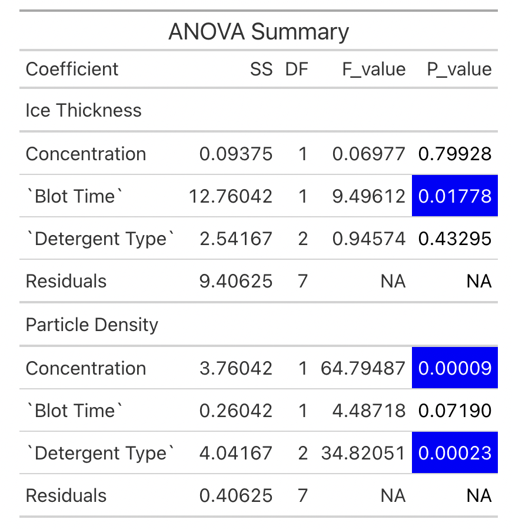
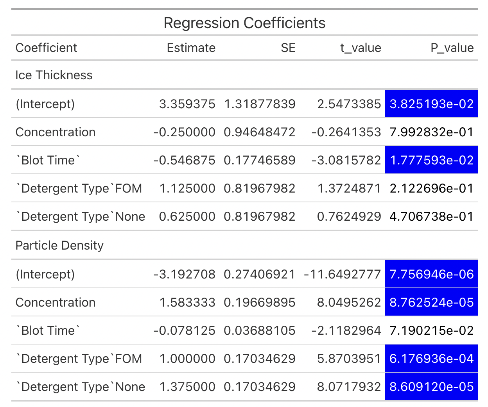

#### Introduction

When a user clicks the button "Run Statistical Analysis", a linear model is created based on the inputs provided. A separate linear model is created for each distinct response that is selected.

All responses are included in the additive model. No interactions are currently included in these models.

Once the linear model is created, both an ANOVA (analysis of variance) and regression are conducted.

#### ANOVA

ANOVA (Analysis of Variance) is a statistical method that allows users to compare the means of two or more groups.

For non-numeric variables (like Detergent Type), a significant p-value indicates that at least one of the groups is statistically different from the others. Here we have three possible detergent types: FOM, CHAPSO, and None. The response Particle Density has a p-value of 0.00023 for Detergent Type. This indicates that at least one of those three detergent types has a mean value that is significantly different from the others. In contrast, the p-value for this variable for Ice Thickness is 0.43295. This suggests that the ice thickness values are not statistically significant from each other at 0.05 threshold.

For numeric predictors such as Blot Time and Concentration, an ANOVA result indicates whether the predictor has an impact on the response. A p-value less than 0.05 indicates that the variable is statistically significant and has an impact on the response. For Ice Thickness, the p-value for Concentration is 0.79928 (suggesting it does not have an impact on Ice Thickness), but the p-value for Blot Time is 0.01778 (suggesting it has an impact on Ice Thickness).

It must be noted that for both categorical and numeric predictors, ANOVA simply indicates that there is a difference, and does not specify the direction or magnitude.

```{r setup, include=FALSE}
library(here)
```

{#id .class width=50% height=50%}

#### Linear Regression

Linear regression can be helpful when the direction and magnitude of the predictors are desired to be known.

For numeric variables, the coefficient indicates the impact of a one-unit increase in the predictor on the level of the response. For categorical variables, the coefficient indicates the difference between the level of interest (say FOM detergent) in contrast to the baseline level (perhaps CHAPSO detergent). For categorical variables, there will be n-1 coefficients where n is the number of groups in that variable.

For Ice Thickness, the variables have the following interpretations:

- Intercept: Keeping Concentration at 0, Blot Time at 0, and Detergent as CHAPSO, the ice thickness is predicted to be 3.359. The intercept is not typically analyzed for statistical significance.
- Concentration: Holding all other variables constant, an increase of concentration by 1 unit decreases the expected ice thickness by 0.25 (however, this is not statistically significant).
- Blot Time: Holding all other variables constant, an increase in the blot time of 1 second decreases the expected ice thickness by 0.547 (which is statistically significant at a p-value threshold of 0.05).
- Detergent Type (FOM): Holding all other variables constant, FOM Detergent is expected to have an ice thickness that 1.125 units larger than CHAPSO Detergent (which is statistically significant at a p-value threshold of 0.05)
- Detergent Type (None): Holding all other variables constant, None Detergent is expected to have an ice thickness that 0.625 units larger than CHAPSO Detergent (which is statistically significant at a p-value threshold of 0.05)

A similar interpretation can be conducted for Particle Density.

{#id .class width=50% height=50%}

#### Important Note

It is important to note that there may be times where ANOVA indicates a predictor to be significant (or not), and the linear regression model indicates otherwise. This can happen. This occurs due to the fact that while the analyses are calculating similar results, they are not identical tests.

